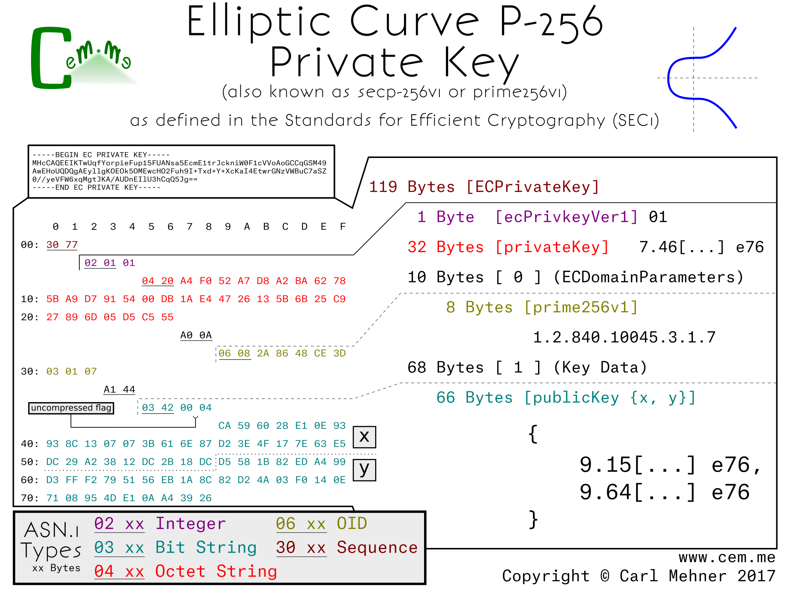

<article markdown="1">

<header markdown="1">

# How to turn a number into a private key

<time class="pubdate" datetime="2026-11-16">2026-11-16</time>

</header>

## The problem

Now that it’s been a while since the eMudhra entropy saga and (most) trust store operators have updated their stores to remove at least the offending intermediate CAs. The big headline came when people picked up that one of the issuer CA’s private keys was just the number four. However, you can’t just throw a ‘4’ into a text file and point openssl at it to sign your own certificates… but there is a fairly easy way!

## Structure

Private key files are very structured; that structure is defined in the Standards for Efficient Cryptography (SEC) created by the international consortium Standards for Efficient Cryptography Group (SECG). You can find a full breakdown of the private key structures I did a while back, [here](https://www.cem.me/20170410-ecc-1.html).



This, along with a standard private key, can be used to create a file that can be used to create a PEM or a pfx / p12 file which is able to be loaded into something like openssl and used to sign your own certificates.

First, use openssl to make your own random private key:
```
openssl ecparam -name secp384r1 -genkey -noout -out private.pem
```
Then, turn it into hex; you can just run the base64 part of the key [through this cyber chef recipe](https://gchq.github.io/CyberChef/#recipe=From_Base64('A-Za-z0-9%2B/%3D',true,false)To_Hex('Space',0))

Find the hex bits that represent your private key, replace them all with 0’s, except for the very last byte, that’s where you put the famous ‘4’.

Last, just reverse the Cyber Chef recipe to put your modified hex back to base64 and there’s your private key!

## The lack of the lack of randomness

Looking at the private key, it’s incredibly obvious that there’s a large non-random element, the reason no one saw this, is that the non-random part is only in the private key. The public key that was loaded into web servers and used to establish trust for all of the clients, still looked completely random. Public keys are made by starting on a static, agreed-upon point on an elliptic curve; that point is then added to itself the number of times set by the private key. Because the initial static point starts at a [random location](https://www.anthropic.com/research/ecdsa-curve-origins) on the curve when you add the point to itself (aka multiply) any number of times, it stays looking random.

</article>
